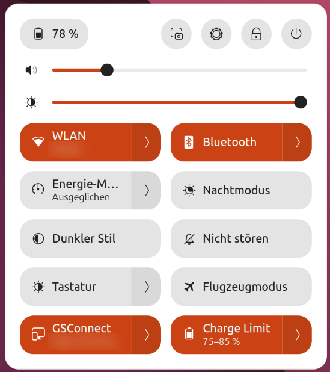
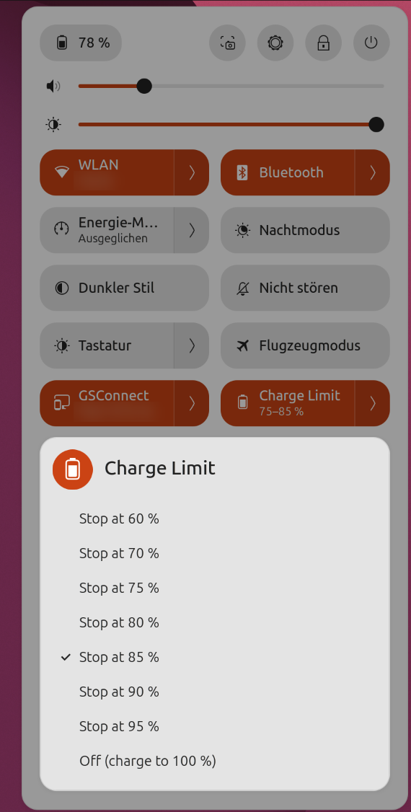

# gnome-charge-limit

GNOME Shell extension (48–50) that sets the laptop battery charge thresholds from Quick Settings.

<p>
  
  
</p>

## Why

GNOME Settings only offers its charge-limit option when UPower reports `ChargeThresholdSupported`.
UPower needs the udev property `CHARGE_LIMIT` for that (from `60-upower-battery.rules`). On the
ThinkPad X9-14 Gen 1 the battery firmware reports a model name with an invalid UTF-8 byte
(`LNV-5B11M90101@\xd0`). udev drops the battery uevents, so no udev DB entry exists, UPower says
"unsupported" and GNOME hides the option. The kernel thresholds themselves work fine.

## How it works

- `system/charge-limit-helper`: root helper that validates `START END` and writes
  `charge_control_{start,end}_threshold` in an order the driver accepts (start < end).
- `system/io.github.chrisotm.charge-limit.policy`: polkit action that lets the active local
  session run the helper via `pkexec` without a password.
- `extension/`: Quick Settings toggle. Click toggles between off and the last limit;
  the menu offers stop limits 60–95 %. Start threshold = stop − 10 % (e.g. 70–80 %: charging
  stops at 80 % and resumes below 70 %). "Off" writes 99/100, because ThinkPad firmware silently
  ignores a start threshold of 0 and would keep the old one.

## Install

```
./install.sh
```

Then log out and back in (Wayland) and enable the extension if needed:
`gnome-extensions enable charge-limit@chrisotm.github.io`.

Thresholds persist in the embedded controller across reboots, so no boot service is needed.

## Uninstall

```
gnome-extensions uninstall charge-limit@chrisotm.github.io
sudo rm /usr/local/libexec/charge-limit-helper \
        /usr/share/polkit-1/actions/io.github.chrisotm.charge-limit.policy
```

## License

MIT
